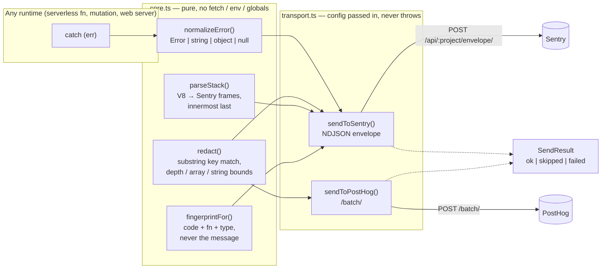

# lite-telemetry

Sentry and PostHog over `fetch`. No vendor SDKs. One over-redacting PII scrubber shared by both.

Extracted from the production observability layer of a trucking operations
platform, where errors are reported from serverless functions, a hosted
backend runtime and a bundled web server, and every one of them is caught
around driver, load and payment data.

## Why this exists

Two reasons, and the second one is the load-bearing one.

**The SDKs do not fit.** Both vendors' Node SDKs assume a long-lived process:
they install global handlers and flush events from a background queue. A
serverless function or edge runtime is not that: no Node built-ins, tight
bundle limits, no background work after the response. In production the
vendor's framework SDK could not be linked into the web app's server bundle at
all — static import or dynamic, it failed the bundler's export resolution.
Hand-rolling two wire formats is about eighty lines and removes the whole
class of problem.

**Redaction has to be identical everywhere.** Every service reports errors that
were caught around driver, load and payment data. A redactor that is subtly
different per service is a redactor that leaks from whichever service got the
least attention. There is one implementation, it over-redacts on purpose, and
it is the only part of this package with heavy test coverage — because it is
the part that fails silently in production.

## Architecture



- **`core.ts` is pure.** Redaction, error normalisation, stack parsing,
  fingerprinting, id generation. No network, no environment, no globals, so it
  runs in a database mutation (which cannot make network calls at all) and in a
  test with equal ease. The code that *decides what to report* has to be
  callable from there; only the code that *transmits* needs a runtime with
  `fetch`.
- **`transport.ts` takes configuration as an argument** rather than reading
  `process.env`, because the callers do not agree on where configuration lives:
  one backend has deployment env vars, the web server has its host's, another
  service has its own prefixed set, and none should be assumed by the others.
- **Over-redaction is the policy, not an accident.** Sensitive keys are matched
  as substrings after stripping separators, so `driverEmail`, `x-api-key`,
  `api_key` and `CONTACT_PHONE` are all caught. `name` and `address` are on the
  list, which redacts some harmless fields — a short allowlist (`filename`,
  `hostname`, `tableName`, …) rescues the common ones. A lost debugging field
  costs a follow-up question; a leaked driver phone number costs a privacy
  incident.
- **The redactor never throws.** It runs inside `catch` blocks on arbitrary
  shapes, so cycles, functions, bigints and huge arrays all degrade to bounded
  placeholders instead of turning a reportable error into an unreportable one.
- **Fingerprints exclude the message.** Messages routinely embed ids ("load
  ld_456 has no stops"), which would otherwise open a fresh Sentry issue per
  record and bury the pattern. Callers pass a stable `code` instead.
- **Skipped is not failed.** Both senders return `{ ok, skipped?, status?, error? }`
  and never throw. A missing DSN is `skipped`, not a failure — the distinction
  matters, because "not configured" and "failed to deliver" look identical in
  production otherwise and that ambiguity is how a deployment believes it has
  error reporting for a month before finding out it does not.

Tradeoffs accepted: no breadcrumbs, no automatic global handlers, no retry
queue, no sampling. In a serverless function the call either goes out before
the function returns or it does not, and a background queue would only hide
that.

## Quick start

Requires Node 20+ and pnpm.

```bash
pnpm install
pnpm test        # 25 tests
pnpm example     # end-to-end against a local mock server, no accounts needed
```

`pnpm example` starts a local HTTP server that impersonates both vendors'
ingest endpoints, reports an error with a deliberately PII-laden context and a
two-event PostHog batch, then prints exactly what went over the wire:

```text
=== Sentry envelope (as received by the mock) ==========================
POST /api/42/envelope/
X-Sentry-Auth: Sentry sentry_version=7, sentry_client=lite-telemetry/1.0, sentry_key=examplepublickey
item header:     {"type":"event","length":1238}
event:
  ...
  "fingerprint": ["load.missing_stops", "loads.assignDriver", "Error"],
  "extra": {
    "loadId": "ld_456",
    "driverEmail": "[redacted]",
    "driverPhone": "[redacted]",
    "pickup": { "latitude": "[redacted]", "longitude": "[redacted]", "city": "Atlanta" },
    "request": { "headers": { "authorization": "[redacted]", "content-type": "application/json" } },
    ...
=== Delivered vs skipped vs failed =====================================
sentry   (configured):      {"ok":true,"status":200}
sentry   (no DSN):          {"ok":false,"skipped":true}
posthog  (upstream 500):    {"ok":false,"status":500,"error":"mock upstream error"}
```

## Using it

```ts
import { normalizeError, sendToPostHog, sendToSentry } from 'lite-telemetry'

try {
  await assignDriver(loadId)
} catch (err) {
  const result = await sendToSentry(
    { dsn: process.env.SENTRY_DSN, environment: 'production', service: 'web-server' },
    {
      level: 'error',
      code: 'load.assign_failed',   // stable grouping key, no ids
      fn: 'loads.assignDriver',     // becomes the Sentry transaction
      error: normalizeError(err),
      orgId,
      extra: { loadId, driverEmail }, // driverEmail is redacted before sending
    },
  )
  if (result.skipped) console.warn('Sentry not configured')
}

await sendToPostHog(
  { apiKey: process.env.POSTHOG_KEY, environment: 'production', service: 'web-server' },
  [{ event: 'load_assigned', distinctId: userId, orgId, properties: { loadId } }],
)
```

The package is TypeScript source (`main: src/index.ts`); consume it from a
bundler or a TS-aware runtime, or copy the two files — that is the intended use.

## Tests

```bash
pnpm typecheck
pnpm test
```

- `tests/telemetry.test.ts` (19 tests, from production) — the redactor removes
  personal data at every depth and in every key convention, keeps the ids a
  report is useless without, survives cycles, and bounds output size; error
  normalisation handles everything that is legal to `throw`; stack parsing
  produces Sentry-ordered frames and marks dependency frames out-of-app;
  fingerprints ignore messages; DSN parsing rejects every unusable shape.
- `tests/transport.test.ts` (6 tests, added for this repo) — the senders
  against a real local HTTP server: envelope is three NDJSON lines whose item
  `length` matches the payload's UTF-8 byte length, `extra` and PostHog
  properties are redacted before they leave the process, a missing DSN sends
  nothing and reports `skipped`, an unreachable host and an upstream 500 report
  failure without throwing.

## What was left out

The production callers: the per-runtime wrappers that read each service's
environment, the database-backed error log that mirrors Sentry for in-app
display (only `toLogSeverity` remains as a hint of it), request-scoped trace
propagation, and the product-specific error-code catalogue. What remains is the
part that is identical across every caller.

## License

MIT
